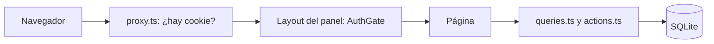

# Arquitectura y tecnologías

**Para qué:** el panel es una sola aplicación web que corre en una máquina del equipo. No usa servicios externos ni tiene una API pública: las pantallas, los datos y los cambios viven en el mismo proceso, y los datos quedan en un archivo local (ver [[Base de datos SQLite]]).

## Piezas principales

- **Next.js 16** con App Router y *Cache Components* activado. El control de acceso de entrada va en `proxy.ts`, no en un `middleware`.
- **React 19** para las pantallas. Las lecturas se hacen en el servidor y los formularios llaman a *acciones del servidor* (ver [[Lecturas y acciones del servidor]]).
- **Tailwind v4**, con la paleta propia de MT (ver [[Identidad visual y paleta]]).
- **better-sqlite3** para la base y **bcryptjs** para las contraseñas.
- **Vitest** para las pruebas y **pnpm** como gestor de paquetes, con la versión fijada en `package.json`.

## Cómo viaja un pedido

Primero, el proxy solo mira si existe la cookie de sesión. Después, el layout verifica la sesión de verdad. La página pide los datos a `queries.ts`, los cambios pasan por `actions.ts` y todo termina en la base.

## Aviso para quien toque el código

Este Next.js tiene cambios respecto de lo que se conoce de versiones anteriores. El archivo `AGENTS.md` pide leer la documentación que viene dentro de `node_modules/next/dist/docs/` antes de escribir código.

## Relacionado

- [[Estructura del código]]
- [[Lecturas y acciones del servidor]]
- [[Base de datos SQLite]]
- [[Acceso, sesiones y seguridad]]
- [[Panel MT]]
