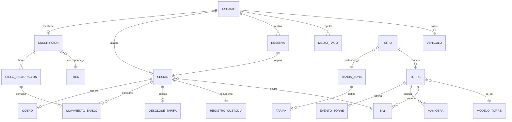

# BD - Modelo de datos

Volver a [[Resumen]] · Stack en [[BD - Stack]]

Fuente: sección 14 del doc técnico. Agregados de las Notas marcados con ➕.

## Diagrama

---

## Personas y autos

**USUARIO** — `id`, `email`, `telefono`, `nombre`, `estado`, `creado_en`
➕ `dni`, `fecha_nacimiento`, `domicilio`, datos de licencia, `foto_url`

**VEHICULO** — `id`, `usuario_id`, `patente`, `marca`, `modelo`, `alto_mm`, `largo_mm`, `ancho_mm`, `peso_kg`, `activo`
➕ `cedula`
**Las dimensiones son obligatorias.**

**MEDIO_PAGO** — `id`, `usuario_id`, `token_pasarela`, `ultimos_4`, `marca`, `vencimiento`, `es_principal`
**Nunca** el número completo de tarjeta.

---

## Lugar físico

**SITIO** — `id`, `nombre`, `direccion`, `latitud`, `longitud`, `banda_zona_id`, horarios, `estado`
Estado: `OPERATIVO`, `CON_DEMORAS`, `FUERA_DE_SERVICIO` (se deriva de sus torres).

**MODELO_TORRE** — `fabricante`, `denominacion`, `capacidad_bays`, `alto_max_mm`, `largo_max_mm`, `ancho_max_mm`, `peso_max_kg`, `tiempo_ciclo_base_s`, `tiempo_por_posicion_s`, `tipo_adaptador`
**Todo lo que cambia entre fabricantes vive acá.**

**TORRE** — `sitio_id`, `modelo_torre_id`, `identificador`, `estado`, `posicion_carrusel_actual`, `endpoint_plc`, `ultimo_heartbeat_en`

**BAY** — `torre_id`, `numero`, `posicion_circuito`, `estado`, `vehiculo_actual_id`
Estado: `LIBRE`, `RESERVADO`, `OCUPADO`, `LIBERANDO`, `BLOQUEADO`.
**La fuente de verdad es el PLC.** La tabla es un reflejo.

---

## Uso

**RESERVA** — `usuario_id`, `vehiculo_id`, `sitio_id`, `inicio_previsto`, `fin_previsto`, `estado`, `codigo_acceso`, `costo_estimado_centavos`
Estados: `PENDIENTE_PAGO` → `CONFIRMADA` → `EN_USO` → `CUMPLIDA` (o `CANCELADA`, `NO_SHOW`, `RECHAZADA`, `AFECTADA`).

**SESION** — `usuario_id`, `vehiculo_id`, `reserva_id` (null si walk-in), `torre_id`, `bay_id`, `ingreso_en`, `egreso_en`, `estado`, `es_walk_in`, `segundos_congelados`
**La sesión es lo que se cobra, no la reserva.**

**REGISTRO_CUSTODIA** — `sesion_id`, `tipo` (INGRESO/EGRESO), `timestamp`, `patente_leida`, `uri_evidencia`, `hash_evidencia`
**Inmutable.** Es la prueba legal.

---

## Dinero y planes

**TIER** — `nombre`, `banda_zona_id`, `precio_mensual_centavos`, `horas_banco`, `es_ilimitado`, `tarifa_overage_centavos_hora`, `vigente_desde`, `vigente_hasta`

**SUSCRIPCION** — `usuario_id`, `tier_id`, `estado`, `inicio`, `proxima_renovacion`, `tier_programado_id`

**CICLO_FACTURACION** — `suscripcion_id`, `inicio`, `fin`, `tier_id`, `importe_cobrado_centavos`

**MOVIMIENTO_BANCO** — `ciclo_facturacion_id`, `tipo`, `minutos` (+ acredita / − consume), `sesion_id`, `motivo`
Tipos: `ACREDITACION`, `CONSUMO`, `AJUSTE`, `EXPIRACION`, `PRORRATEO`.
**Append-only.** Nunca se edita ni se borra.

**DESGLOSE_TARIFA** — `duracion_segundos`, `bloques_15min`, `minutos_de_banco`, `minutos_overage`, importes en centavos, `snapshot_reglas` (JSON)

**COBRO** — `importe_centavos`, `estado`, `clave_idempotencia`, `referencia_pasarela`, `intentos`

---

## Torre (técnico)

**MANIOBRA** — `torre_id`, `tipo`, `sesion_id`, `bay_id`, `estado`, tiempos, `codigo_falla`, `clave_idempotencia`
**EVENTO_TORRE** — bitácora append-only de todo lo que reporta el PLC.

---

## Decisiones clave

1. **Banco de horas = libro de movimientos**, no un contador. Saldo = `SUM(minutos)`.
2. **Tarifas y planes versionados** por fecha. Cambiar un precio crea una fila nueva.
3. **Todo importe en centavos** (`Int`). Nunca `Float`.
4. **Custodia, movimientos y eventos son inmutables.**
5. **Multi-sitio desde el día uno.**

Reglas en [[RN - Índice]]. Privacidad en [[BD - Privacidad]].
